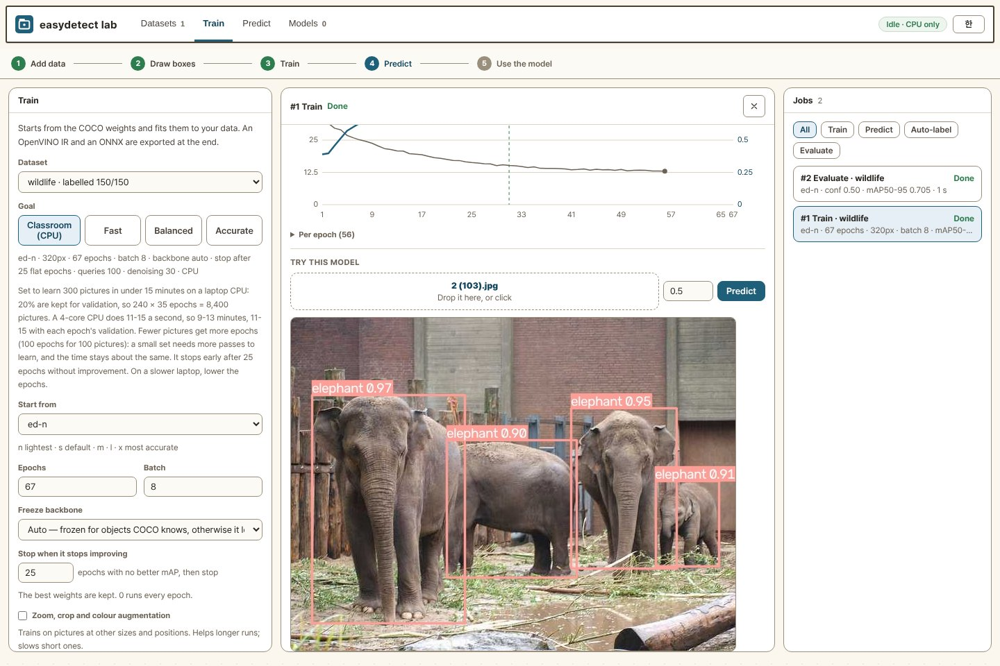
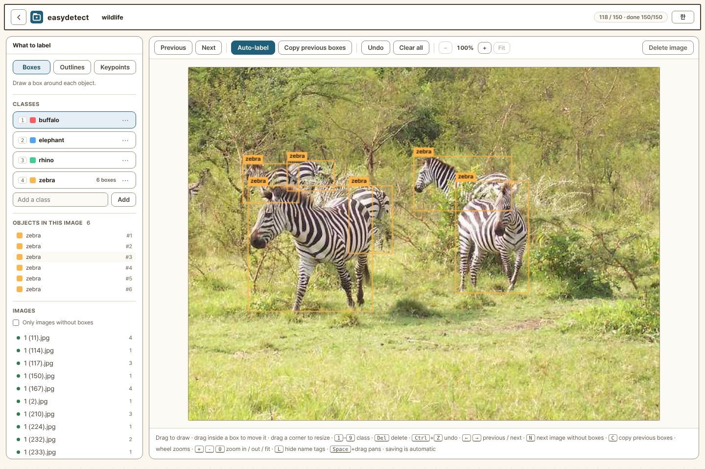

# easydetect lab

[한국어](README.md) · **English** · [Guide](https://themakerrobot.github.io/easydetect-lab/)

Make an object detector from your own pictures: add pictures → label → train →
test → export, all in the lab. On a classroom laptop's CPU, offline, 100–300
pictures train in 10–15 minutes.



## Install

| where | how |
| --- | --- |
| Windows, offline | take the zip from [releases](https://github.com/themakerrobot/easydetect-lab/releases), unzip, double-click `start-lab-offline.bat` |
| Windows, online | get this repository, double-click `start-lab.bat` (Python 3.10–3.13, *Add python.exe to PATH*) |
| macOS · Linux | the commands below |

```bash
git clone https://github.com/themakerrobot/easydetect-lab
cd easydetect-lab
pip install -r requirements.txt
python run.py                  # http://127.0.0.1:8080
```

- Offline zips: `…-win64.zip` (any laptop), `…-win64-intel-gpu.zip` (Core Ultra, Arc: trains on the GPU)
- Ubuntu: install into a virtual environment, with CPU PyTorch first when there is no GPU:
  `python3 -m venv .venv && .venv/bin/pip install torch torchvision --index-url https://download.pytorch.org/whl/cpu && .venv/bin/pip install -r requirements.txt`
- Training on a GPU: install PyTorch's GPU build (NVIDIA `…/whl/cu128`, Intel `…/whl/xpu`);
  the GPU's name shows top right when it is used.
- For teachers: [docs/classroom.md](docs/classroom.md) (Korean)

## How it works

1. **Add data**: pictures, videos, zips, folders. A YOLO-format zip (Roboflow's) comes with its labels.
2. **Label**: drag a box; class names can be in any language. **Auto-label**
   draws them first, you correct them.

   

   | key | does |
   | --- | --- |
   | <kbd>1</kbd>–<kbd>9</kbd> | class |
   | <kbd>C</kbd> | copy the last picture's boxes |
   | <kbd>Del</kbd> · <kbd>Ctrl</kbd>+<kbd>Z</kbd> | delete · undo |
   | wheel · <kbd>Space</kbd>+drag | zoom · pan |

3. **Train**: without a GPU the **classroom (CPU)** setting is picked, with the
   epochs set from the picture count. Then: per-class accuracy and the pictures it got wrong.
4. **Test**: a picture, a folder, a video, a webcam. Another PC's webcam: `https://<this PC>:8443`.
5. **Export**: one `.onnx` (Pibo, a Raspberry Pi, a PC), OpenVINO IR (Intel CPU, GPU, NPU),
   `best.pt`, a Hugging Face folder, code to run it.

Besides boxes: **outlines** (MobileSAM draws them, <kbd>S</kbd>) and **keypoints**
(name the points once, then click them in order).

## Good to know

- No login. Opened to other PCs (`--host 0.0.0.0`), anyone on that network can use it.
- Data stays on this PC, in `easydetect-lab/` (`data/` in the offline bundle); `--data` moves it.
- One training at a time. Closing the app stops it, keeping its best result so far.
- Updating: `git pull` for the app, `pip install -U "easydetect[train]"` for the package, a new zip offline.
- License: the app, the model code and the weights are Apache-2.0, and so is a model
  you train on your own pictures. Starting from an easydetect hub model: check its dataset's terms.

## More

- [docs/pibo-integration.md](docs/pibo-integration.md): on a robot or a Raspberry Pi
- [docs/reference.md](docs/reference.md): every feature, the HTTP API, where files go
- The detection package: [easydetect](https://github.com/themakerrobot/easydetect)
