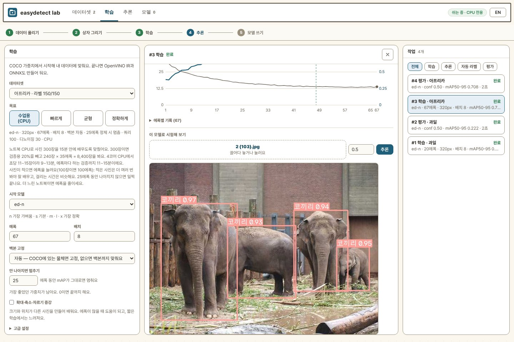
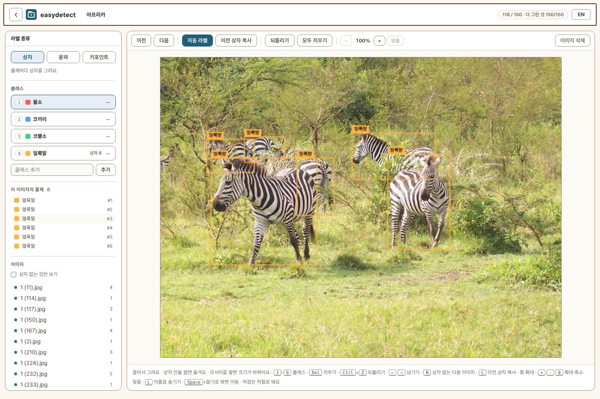

# easydetect lab

[English](README.md) · **한국어**

내 사진으로 물체 인식 모델을 만드는 앱입니다. 브라우저 하나에서 사진 올리기 →
상자 그리기 → 학습 → 시험 → 내보내기까지 합니다. 인터넷 없는 교실의
노트북 CPU에서도 사진 100~300장을 10~15분 안에 학습합니다.



## 시작하기

**인터넷 없는 교실 (Windows)**: [릴리스](https://github.com/themakerrobot/easydetect-lab/releases)에서
zip을 받아 풀고 `start-lab-offline.bat`을 더블클릭합니다. 설치할 것도, 내려받을
것도 없습니다.

| 파일 | 쓰는 곳 |
| --- | --- |
| `easydetect-lab-offline-win64.zip` | 보통 노트북 (CPU로 학습) |
| `easydetect-lab-offline-win64-intel-gpu.zip` | 인텔 GPU 노트북 (Core Ultra, Arc): 학습이 GPU에서 돌아요 |

선생님용 안내(준비물, 수업 순서, 문제 해결): [docs/classroom.md](docs/classroom.md)

**인터넷 되는 Windows PC**: 이 저장소를 받아 `start-lab.bat`을 더블클릭합니다.
처음 한 번 몇 분 동안 설치하고 브라우저가 열립니다.
[Python](https://www.python.org/downloads/) 3.10~3.13(3.12 권장)을 *Add python.exe
to PATH*로 설치해 두세요.

**명령줄 (Windows · macOS · Linux)**

```bash
git clone https://github.com/themakerrobot/easydetect-lab
cd easydetect-lab
pip install -r requirements.txt
python run.py                  # http://127.0.0.1:8080
```

**GPU로 학습하기**: GPU가 없어도 됩니다. 있으면 PyTorch를 GPU용으로 한 번 바꿔
깔면 자동으로 씁니다. 화면 오른쪽 위에 *CPU 전용* 대신 GPU 이름이 나오면 된 거예요.

```bat
rem NVIDIA
.venv\Scripts\python -m pip install torch torchvision --index-url https://download.pytorch.org/whl/cu128
rem 인텔 GPU (Arc, Core Ultra)
.venv\Scripts\python -m pip install torch torchvision --index-url https://download.pytorch.org/whl/xpu
```

화면 오른쪽 위 **EN / 한** 버튼으로 영어·한국어를 바꿉니다.

## 쓰는 순서

화면 위쪽의 다섯 단계를 따라가면 됩니다.

1. **데이터 올리기**: 사진 여러 장, 영상(일정 간격으로 프레임을 뽑음), zip,
   이 PC의 폴더를 올립니다. Roboflow 등에서 받은 YOLO 형식 zip은 라벨째 들어갑니다.
2. **상자 그리기**: 마우스로 끌어서 상자를 그립니다. 클래스 이름은 한글도 됩니다.

   

   | 키 | 하는 일 |
   | --- | --- |
   | <kbd>1</kbd>~<kbd>9</kbd> | 클래스 바꾸기 |
   | <kbd>C</kbd> | 이전 사진의 상자 복사 (고정 카메라에 편해요) |
   | <kbd>Del</kbd> · <kbd>Ctrl</kbd>+<kbd>Z</kbd> | 지우기 · 되돌리기 |
   | 휠 · <kbd>Space</kbd>+끌기 | 확대 · 이동 |

   저장은 자동입니다. **자동 라벨**을 누르면 모델이 먼저 상자를 그려 주고,
   사람은 고치기만 하면 됩니다. 사과·컵·사람처럼 COCO가 아는 물체는 처음부터
   됩니다. **통계**에서는 클래스별 상자 수와 빠뜨린 라벨을 확인합니다.
3. **학습**: 데이터셋과 목표를 고르고 *학습*을 누릅니다.
   - **수업용 (CPU)**: GPU가 없으면 자동으로 골라집니다. 에폭은 사진 수에 맞춰 정해집니다.
   - **빠르게 / 균형 / 정확하게**: GPU가 있을 때 쓰세요.
   - 나머지 설정은 데이터를 보고 스스로 정합니다. 학습 곡선과 남은 시간이 실시간으로
     나오고, 끝나면 *평가*로 클래스별 정확도와 정답·예측을 겹친 사진을 봅니다.
4. **추론**: 사진 한 장, 폴더, 영상, 웹캠으로 바로 시험합니다. 확신 기준은
   0.5에서 시작합니다. 다른 PC에서 웹캠을 쓰려면 `https://<이 PC>:8443`으로 여세요.
5. **모델 쓰기**: 끝난 학습에서 내려받습니다.
   - **ONNX 파일 하나**: 클래스 이름과 확신 기준이 든 `.onnx` 하나입니다.
     onnxruntime만 있으면 파이보·라즈베리파이·PC 어디서든 돌아갑니다
     (라즈베리파이 4B에서 한 장 약 0.16초). [docs/pibo-integration.md](docs/pibo-integration.md)
   - **OpenVINO IR**: 인텔 CPU·GPU·NPU에서 가장 빠릅니다.
   - `best.pt`(PyTorch), Hugging Face 업로드용 묶음, 바로 쓸 수 있는 코드 예시도 있습니다.

### 윤곽과 키포인트

라벨링 화면 왼쪽 위 **라벨 종류**에서 고릅니다. 학습할 때 시작 모델은 똑같이
ed-n~x이고, 데이터셋에 그린 라벨에 따라 단계가 더해집니다.

- **윤곽 (세그멘테이션)**: 상자를 그리면 AI(MobileSAM)가 윤곽을 따 줍니다
  (<kbd>S</kbd>). <kbd>P</kbd>로 점을 찍어 직접 그릴 수도 있어요. 학습하면 상자
  모델 다음에 윤곽 모델을 내 데이터에 맞춥니다.
- **키포인트 (자세)**: 점 이름을 한 번 정하고(*COCO 사람 17점* 버튼도 있어요),
  상자를 그린 뒤 점을 차례로 클릭합니다. <kbd>Shift</kbd>+클릭은 가려진 점입니다.

## 알아 둘 것

- **로그인이 없습니다.** 기본은 이 PC에서만 열립니다. `python run.py --host 0.0.0.0`
  (또는 `start-lab.bat --host 0.0.0.0`)으로 다른 PC에 열면 그 네트워크의 누구나 쓸 수
  있으니, 믿을 수 있는 네트워크에서만 여세요.
- **데이터는 이 PC에만 있습니다.** 실행한 폴더의 `easydetect-lab/`에 쌓입니다
  (오프라인 묶음은 묶음 안의 `data/`). `--data <폴더>`로 옮길 수 있습니다.
- **학습은 한 번에 하나씩** 순서대로 돕니다. 앱을 끄면 진행 중인 학습도 멈추지만,
  그때까지 가장 좋았던 결과는 남습니다.
- **업데이트**: 앱은 `git pull`, 모델 패키지는 `pip install -U "easydetect[train]"`.
  오프라인 묶음은 새 zip을 받으세요.
- **라이선스**: 앱, 모델 코드와 가중치 모두 Apache-2.0입니다. 수업·제품에 자유롭게 쓸 수 있어요.

## 더 보기

- [docs/classroom.md](docs/classroom.md): 교실 준비와 문제 해결
- [docs/pibo-integration.md](docs/pibo-integration.md): 파이보·라즈베리파이에서 쓰기
- [docs/reference.md](docs/reference.md): 기능 전체 설명, HTTP API, 폴더 구조,
  보안 설정, 소스에서 실행하기 (영어)
- 검출 패키지: [easydetect](https://github.com/themakerrobot/easydetect)
