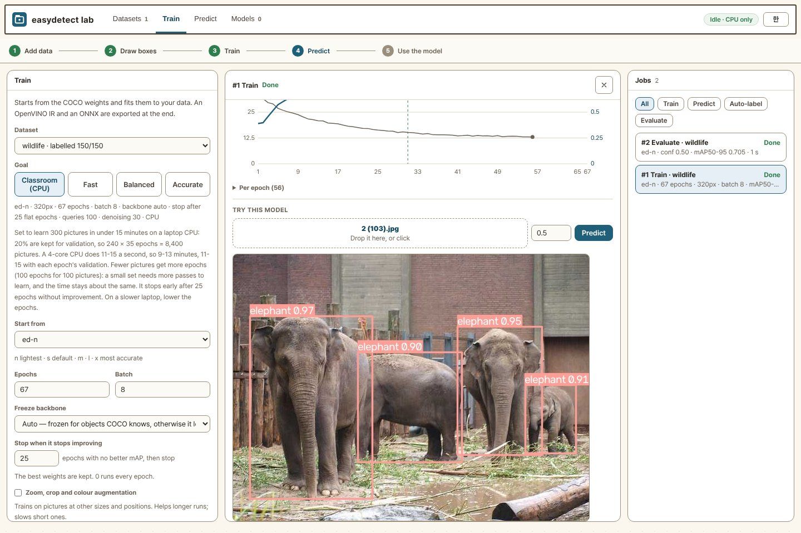
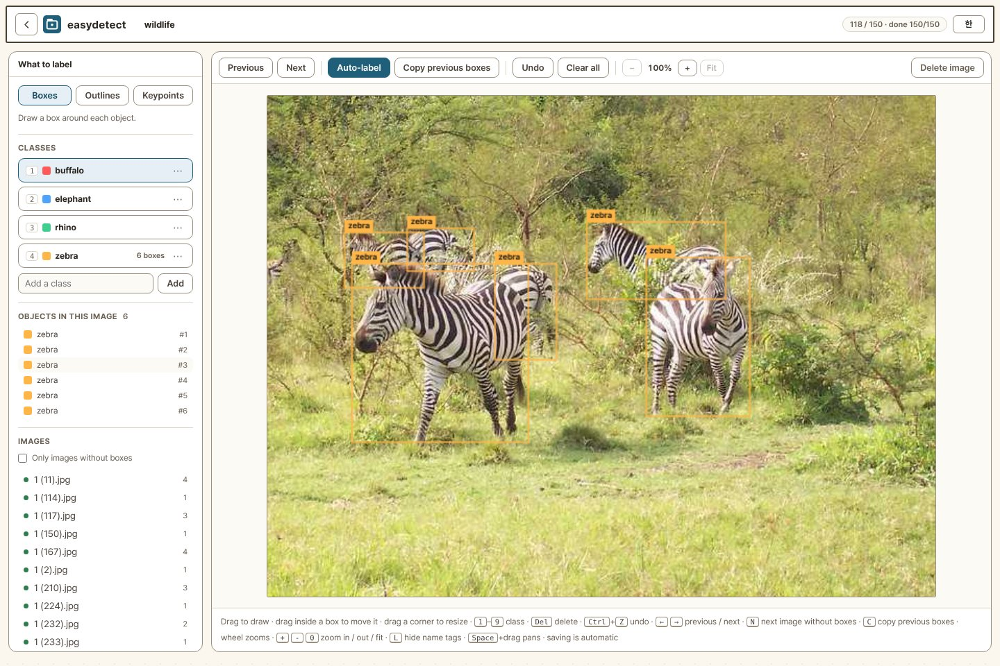

# easydetect lab

**English** · [한국어](README.ko.md)

Make an object detector from your own pictures, in a browser: add pictures →
draw boxes → train → try it → take it away. On a classroom laptop's CPU with
no internet, 100–300 pictures train in 10–15 minutes.



## Getting started

**A classroom with no internet (Windows)**: download a zip from the
[releases](https://github.com/themakerrobot/easydetect-lab/releases), unzip it
and double-click `start-lab-offline.bat`. Nothing is installed and nothing is
downloaded.

| File | For |
| --- | --- |
| `easydetect-lab-offline-win64.zip` | any laptop (trains on the CPU) |
| `easydetect-lab-offline-win64-intel-gpu.zip` | laptops with an Intel GPU (Core Ultra, Arc): training runs on the GPU |

For teachers (what to prepare, a lesson plan, troubleshooting), in Korean:
[docs/classroom.md](docs/classroom.md)

**A Windows PC with internet**: get this repository and double-click
`start-lab.bat`. The first time it installs for a few minutes, then opens the
browser. Install [Python](https://www.python.org/downloads/) 3.10–3.13 (3.12
is safest) with *Add python.exe to PATH* first.

**Command line (Windows, macOS, Linux)**

```bash
git clone https://github.com/themakerrobot/easydetect-lab
cd easydetect-lab
pip install -r requirements.txt
python run.py                  # http://127.0.0.1:8080
```

**Training on a GPU**: not needed, but used when there is one. Swap PyTorch
for its GPU build once; when the top right shows the GPU's name instead of
*CPU only*, it worked.

```bat
rem NVIDIA
.venv\Scripts\python -m pip install torch torchvision --index-url https://download.pytorch.org/whl/cu128
rem Intel GPU (Arc, Core Ultra)
.venv\Scripts\python -m pip install torch torchvision --index-url https://download.pytorch.org/whl/xpu
```

The **EN / 한** button at the top right switches the screens between English
and Korean.

## How it goes

Follow the five steps along the top of the screen.

1. **Add data**: pictures, a video (frames are taken at an interval), a zip, or
   a folder on this PC. A YOLO-format zip from Roboflow and the like comes in
   with its labels.
2. **Draw boxes**: drag to draw a box. Class names can be in any language.

   

   | Key | Does |
   | --- | --- |
   | <kbd>1</kbd>–<kbd>9</kbd> | set the class |
   | <kbd>C</kbd> | copy the previous picture's boxes (handy for a fixed camera) |
   | <kbd>Del</kbd> · <kbd>Ctrl</kbd>+<kbd>Z</kbd> | delete · undo |
   | wheel · <kbd>Space</kbd>+drag | zoom · pan |

   Saving is automatic. **Auto-label** has a model draw the boxes first, so you
   only correct them; things COCO knows (an apple, a cup, a person) work from
   the start. **Statistics** counts boxes per class and finds missing labels.
3. **Train**: pick the dataset and a goal, then *Start training*.
   - **Classroom (CPU)**: picked by itself when there is no GPU; the epochs
     follow the number of pictures.
   - **Fast / Balanced / Accurate**: for a PC with a GPU.
   - The rest is set from the data. The curve and the time left update live;
     afterwards, *Evaluate* shows the accuracy per class and the pictures with
     the truth and the prediction drawn over each other.
4. **Predict**: try it on a picture, a folder, a video or the webcam. The
   confidence threshold starts at 0.5. For the webcam from another PC, open
   `https://<this PC>:8443`.
5. **Use the model**: download it from the finished run.
   - **One ONNX file**: one `.onnx` with the class names and the confidence
     threshold inside. Anything with onnxruntime runs it — a robot, a
     Raspberry Pi, a PC (about 0.16 s a picture on a Raspberry Pi 4B).
     [docs/pibo-integration.md](docs/pibo-integration.md)
   - **OpenVINO IR**: fastest on Intel CPUs, GPUs and NPUs.
   - Also `best.pt` (PyTorch), a folder ready to upload to Hugging Face, and
     code to copy.

### Outlines and keypoints

Pick them under **What to label**, top left of the labelling screen. Training
starts from the same ed-n … ed-x; the dataset's labels add a stage.

- **Outlines (segmentation)**: draw a box and AI (MobileSAM) traces the
  outline (<kbd>S</kbd>), or place the points yourself with <kbd>P</kbd>.
  Training fits the outline model to your data after the box model.
- **Keypoints (pose)**: name the points once (*COCO people, 17 points* fills
  them in), then draw a box and click its points in order;
  <kbd>Shift</kbd>+click places a hidden point.

## Good to know

- **There is no login.** By default only this PC can open it.
  `python run.py --host 0.0.0.0` (or `start-lab.bat --host 0.0.0.0`) opens it
  to other PCs — and to anyone on that network, so do it only on one you trust.
- **The data stays on this PC**, in `easydetect-lab/` in the folder you start
  from (`data/` inside the offline bundle); `--data <folder>` moves it.
- **One training at a time**, in order. Closing the app stops a run, but its
  best result so far is kept.
- **Updating**: the app with `git pull`, the model package with
  `pip install -U "easydetect[train]"`; the offline bundle by taking the new zip.
- **License**: the app, the model code and the weights are all Apache-2.0,
  free for classes and products alike.

## More

- [docs/reference.md](docs/reference.md): every feature in detail, the HTTP
  API, where files go, security settings, running from source
- [docs/classroom.md](docs/classroom.md): preparing a classroom (Korean)
- [docs/pibo-integration.md](docs/pibo-integration.md): running on a robot or a Raspberry Pi
- The detection package: [easydetect](https://github.com/themakerrobot/easydetect)
