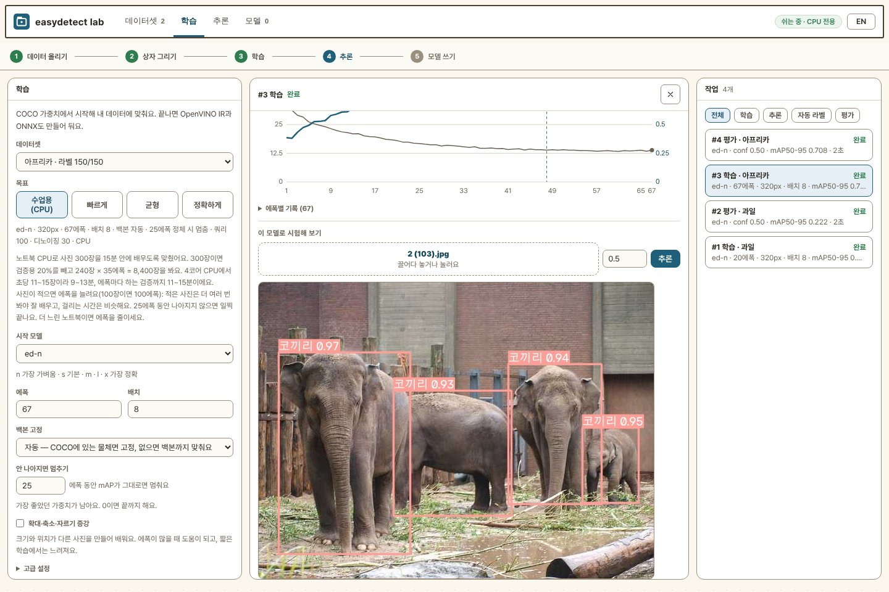
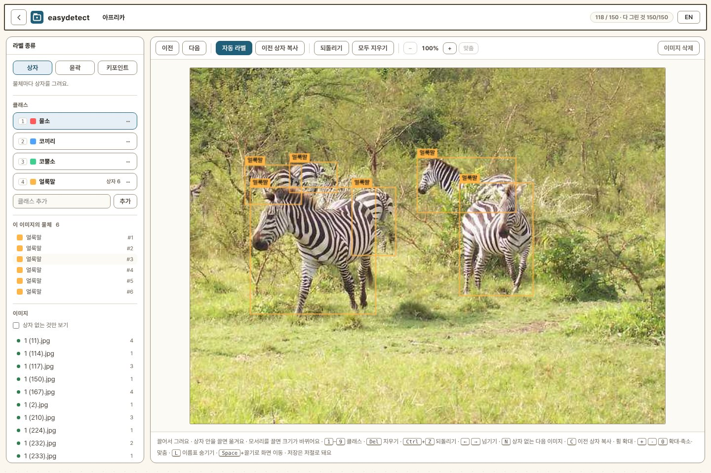

# easydetect lab

**한국어** · [English](README.en.md) · [가이드 페이지](https://themakerrobot.github.io/easydetect-lab/)

내 사진으로 물체 인식 모델을 만드는 앱이에요. 사진 올리기 → 라벨링 → 학습 → 시험 →
내보내기까지 lab 하나로 해요. 인터넷 없는 교실 노트북 CPU에서도 사진 100~300장을
10~15분에 학습해요.



## 설치

| 환경 | 방법 |
| --- | --- |
| 인터넷 없는 Windows | [릴리스](https://github.com/themakerrobot/easydetect-lab/releases)에서 zip을 받아 풀고 `start-lab-offline.bat` 더블클릭 |
| 인터넷 되는 Windows | 이 저장소를 받아 `start-lab.bat` 더블클릭 (Python 3.10~3.13, *Add python.exe to PATH*) |
| macOS · Linux | 아래 명령 |

```bash
git clone https://github.com/themakerrobot/easydetect-lab
cd easydetect-lab
pip install -r requirements.txt
python run.py                  # http://127.0.0.1:8080
```

- 오프라인 zip: `…-win64.zip`(보통 노트북), `…-win64-intel-gpu.zip`(Core Ultra·Arc, GPU로 학습)
- 우분투: 가상환경에 설치하고, GPU가 없으면 CPU용 PyTorch를 먼저 깔아요.
  `python3 -m venv .venv && .venv/bin/pip install torch torchvision --index-url https://download.pytorch.org/whl/cpu && .venv/bin/pip install -r requirements.txt`
- GPU 학습: PyTorch를 GPU용으로 바꿔 깔면 자동으로 써요
  (NVIDIA `…/whl/cu128`, 인텔 `…/whl/xpu`). 오른쪽 위에 GPU 이름이 나오면 된 거예요.
- 선생님용 안내: [docs/classroom.md](docs/classroom.md)

## 쓰는 순서

1. **데이터 올리기**: 사진, 영상, zip, 폴더. YOLO 형식 zip(Roboflow 등)은 라벨째 들어가요.
2. **라벨링**: 끌어서 상자를 그려요. 클래스 이름은 한글도 돼요. **자동 라벨**이
   먼저 그려 주면 고치기만 하면 돼요.

   

   | 키 | 하는 일 |
   | --- | --- |
   | <kbd>1</kbd>~<kbd>9</kbd> | 클래스 바꾸기 |
   | <kbd>C</kbd> | 이전 사진의 상자 복사 |
   | <kbd>Del</kbd> · <kbd>Ctrl</kbd>+<kbd>Z</kbd> | 지우기 · 되돌리기 |
   | 휠 · <kbd>Space</kbd>+끌기 | 확대 · 이동 |

3. **학습**: GPU가 없으면 **수업용 (CPU)**이 골라지고, 에폭은 사진 수에 맞춰 정해져요.
   끝나면 클래스별 정확도와 틀린 사진을 볼 수 있어요.
4. **시험**: 사진, 폴더, 영상, 웹캠. 다른 PC의 웹캠은 `https://<이 PC>:8443`.
5. **내보내기**: `.onnx` 하나(파이보·라즈베리파이·PC), OpenVINO IR(인텔 CPU·GPU·NPU),
   `best.pt`, Hugging Face 업로드 묶음, 코드 예시.

라벨 종류는 상자 말고도 **윤곽**(MobileSAM이 따 줌, <kbd>S</kbd>)과 **키포인트**(점 이름을
정하고 차례로 클릭)가 있어요.

## 알아 둘 것

- 로그인이 없어요. 다른 PC에 열 때(`--host 0.0.0.0`)는 믿을 수 있는 네트워크에서만.
- 데이터는 이 PC의 `easydetect-lab/`(오프라인 묶음은 `data/`)에만 있어요. `--data`로 옮겨요.
- 학습은 한 번에 하나씩 돌아요. 앱을 꺼도 그때까지 가장 좋은 결과는 남아요.
- 업데이트: 앱은 `git pull`, 모델 패키지는 `pip install -U "easydetect[train]"`, 오프라인은 새 zip.
- 라이선스: 앱·모델 코드·가중치 모두 Apache-2.0이고, 내 사진으로 학습한 모델도 상업용으로
  써요. easydetect hub 모델에서 시작하면 그 데이터셋 조건을 확인하세요.

## 더 보기

- [docs/pibo-integration.md](docs/pibo-integration.md): 파이보·라즈베리파이에서 쓰기
- [docs/reference.md](docs/reference.md): 기능 전체, HTTP API, 폴더 구조 (영어)
- 검출 패키지: [easydetect](https://github.com/themakerrobot/easydetect)
